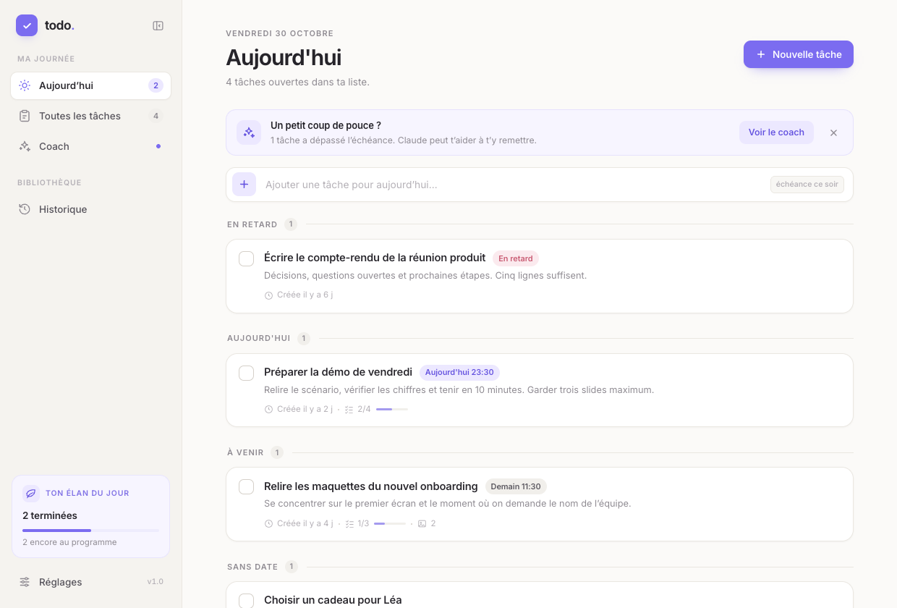

# Todo

Une application de bureau de tâches, douce et épurée : **Go + Wails + Angular + SQLite**.
Thème clair uniquement, six accents pastel, sous-tâches, images, historique par jour et un
coach propulsé par **Claude Code (haiku)**.



## Fonctionnalités

- **Tâches** avec titre, description, échéance (date + heure optionnelle), date de création.
- **Sous-tâches** avec progression, ajout, renommage, suppression.
- **Images** jointes (copiées dans le dossier de données de l'application), avec aperçu plein écran.
- **Aujourd'hui** : tâches en retard, du jour, à venir et sans date, regroupées automatiquement.
- **Toutes les tâches** avec filtres (en retard, aujourd'hui, sans date) et ajout rapide.
- **Historique** des tâches terminées, regroupées par jour, réouvrables d'un clic.
- **Coach Claude Code** : un mot court et bienveillant pour repartir, et un découpage assisté
  des tâches en sous-tâches concrètes. Le coach peut être désactivé dans les réglages.
- **Six accents pastel** : lavande, menthe, ciel, pêche, rose, beurre.
- **Local-first** : SQLite et images stockés sur la machine, aucune donnée envoyée par l'app
  ailleurs qu'à Claude Code lorsque tu le sollicites.
- **Windows et macOS** via Wails, avec CI GitHub Actions.


## Stack

| Couche | Technologie |
| --- | --- |
| Fenêtre desktop | [Wails v2](https://wails.io) |
| Backend | Go, SQLite (`modernc.org/sqlite`, sans CGO) |
| Frontend | Angular 20, composants standalone, signals |
| Coach | CLI locale `claude` (`--model haiku`) |
| CI | GitHub Actions (macOS universel + Windows x64) |

## Prérequis

- Go **1.26+**
- Node.js **22+** et npm
- Wails CLI v2.17 :

```bash
go install github.com/wailsapp/wails/v2/cmd/wails@v2.17.0
wails doctor
```

- Pour le coach : [Claude Code](https://docs.anthropic.com/en/docs/claude-code) installé et connecté
  (`claude --version` doit fonctionner). L'application utilise ton abonnement Claude Code local,
  pas une clé API.

## Développement

```bash
# Application complète (Go + Angular avec hot reload)
wails dev

# Frontend seul, avec le backend mock en mémoire
cd frontend
npm install
npm start        # http://127.0.0.1:34115
```

Le frontend détecte l'absence du pont Wails et bascule sur un jeu de données de démonstration
(`frontend/src/app/mock.ts`). Pratique pour travailler le design sans lancer Go.

Tests et vérifications :

```bash
cd frontend && npm ci && npm run build && cd ..
go test ./...
go vet ./...
```

Le build Angular est nécessaire avant `go test` : le binaire Go embarque `frontend/dist`.
Un fichier `.gitkeep` permet toutefois au projet fraîchement cloné de compiler sans ce build.

## Build

```bash
# macOS (binaire de la machine courante)
wails build

# macOS universel (Intel + Apple Silicon)
wails build -platform darwin/universal

# Windows (à lancer sur Windows, Wails v2 ne cross-compile pas vers Windows)
wails build -platform windows/amd64
```

Les applications sont produites dans `build/bin/`.
Le build macOS n'est pas signé/notarisé par défaut. Pour distribuer sans avertissement
Gatekeeper, ajoute tes secrets de signature Apple dans le workflow, ou ouvre l'app avec
clic droit → Ouvrir.

## Claude Code

L'intégration passe par la CLI locale, sans serveur intermédiaire :

- **Découper une tâche** : `claude -p "<prompt>" --model haiku --output-format text`.
  La réponse est demandée sous forme de tableau JSON, avec un fallback tolérant aux listes.
- **Mot du coach** : un résumé local (retards, âge des tâches, terminées du jour) est envoyé
  à haiku pour produire 2 phrases maximum et une action immédiate.
- Les suggestions ne sont **jamais** ajoutées automatiquement : tu choisis « + » ou « Tout ajouter ».
- Le rappel automatique au démarrage est désactivé par défaut (Réglages → Coach).
- Le coach peut être désactivé entièrement depuis les réglages : la page Coach, le bandeau
  d’accueil et le rappel automatique disparaissent. Le découpage de tâches reste disponible.
- Si `claude` n'est pas dans le `PATH` (fréquent pour une app macOS lancée depuis le Finder),
  l'app cherche aussi `~/.local/bin/claude`, `~/.claude/local/claude`, `/opt/homebrew/bin/claude`,
  `%APPDATA%\npm\claude.cmd`, etc. Un chemin personnalisé est disponible dans les réglages.

## Données

| OS | Dossier |
| --- | --- |
| macOS | `~/Library/Application Support/todo/` |
| Windows | `%AppData%\todo\` |

On y trouve `todo.db` (SQLite, WAL) et le dossier `images/`. Réglages → Données permet
d'ouvrir ce dossier. La suppression est locale : aucune synchronisation cloud.

## CI et releases

`.github/workflows/build.yml` :

- **Tests** sur macOS : build Angular, `go test`, `go vet`.
- **Build** en matrice : `darwin/universal` (`.app` zippée) et `windows/amd64` (`.exe` zippé),
  artefacts téléchargeables depuis chaque run.
- Un tag `v*` crée automatiquement une **GitHub Release** avec les deux archives.

```bash
git tag v1.0.0
git push origin v1.0.0
```

## Structure

```text
.
├── main.go                 # Amorçage Wails + assets Angular embarqués
├── src/                    # Tout le code Go de l'application
│   ├── run.go              # Fenêtre, thème clair, options Wails
│   ├── app.go              # Cycle de vie et état de l'application
│   ├── api_*.go            # API exposée à Angular (tâches, images, réglages…)
│   ├── store*.go           # SQLite : schéma, tâches, sous-tâches, images
│   ├── claude*.go          # Détection Claude Code, prompts, parsing
│   └── types.go            # Structures partagées avec le frontend
├── build/appicon.png       # Icône de l'application
├── frontend/
│   └── src/app/
│       ├── app.component.*       # Shell, navigation, tiroir
│       ├── sidebar/
│       ├── tasks/                # Liste, carte, tiroir d'édition
│       ├── history/
│       ├── coach/
│       ├── settings/
│       └── store.ts              # État Angular (signals)
└── .github/workflows/build.yml
```

## Notes de design

- Pas de mode sombre : le thème clair fait partie de l'identité de l'app.
- Typographie Inter Variable, fond chaud, cartes blanches, ombres très légères.
- L'accent pilote les boutons, cases, badges, halos et l'illustration du coach ; il est
  appliqué instantanément et mémorisé en base.
