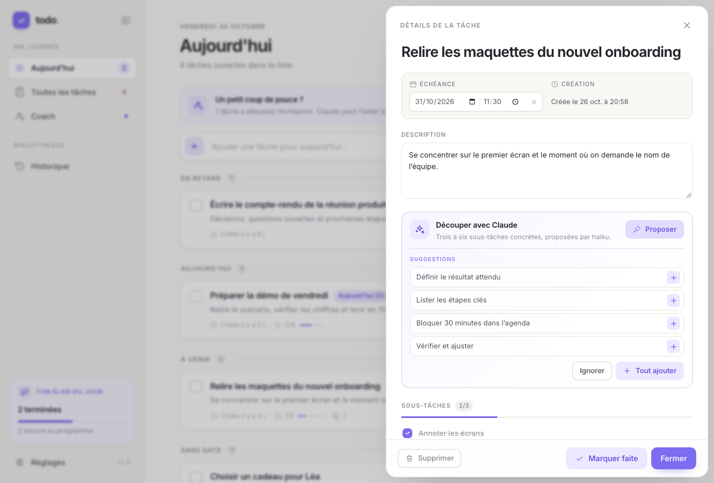

# Todo

Une application de bureau de tâches, douce et épurée : **Go + Wails + Angular + SQLite**.
Thème clair uniquement, six accents pastel, sous-tâches, images, historique par jour et un
coach propulsé par **Claude Code (haiku)**.


## Fonctionnalités

- **Tâches** avec titre, description, échéance (date + heure optionnelle), date de création.
- **Réordonnancement** : glisse les tâches et les sous-tâches par leur poignée pour choisir ton ordre.
- **Profils** (Travail, Perso, …) : des listes séparées qui regroupent leurs propres tâches,
  statistiques et historique. Création, renommage, couleur et suppression depuis le menu ou les réglages.
- **Sous-tâches** avec progression, ajout, renommage, suppression.
- **Images** jointes (copiées dans le dossier de données de l'application), avec aperçu plein écran.
- **Aujourd'hui** : tâches en retard, du jour, à venir et sans date, regroupées automatiquement.
- **Toutes les tâches** avec filtres (en retard, aujourd'hui, sans date) et ajout rapide.
- **Reprendre demain ou lundi** : reporte une tâche au lendemain, ou au lundi quand le week-end
  approche, et met le minuteur en pause.
- **Historique** des tâches terminées, regroupées par jour, réouvrables d'un clic.
- **Notifications bureau** : un rappel natif quand l'échéance d'une tâche ouverte est atteinte,
  avec un bouton de test et une activation dans les réglages.
- **Mises à jour automatiques** : l'app vérifie les GitHub Releases, télécharge la nouvelle
  version en arrière-plan, la vérifie (SHA-256) et l'installe à la fermeture. Un bouton
  « Vérifier les mises à jour » et un redémarrage immédiat sont disponibles dans les réglages.
- **Synchronisation git optionnelle** : un dépôt privé (GitHub, GitLab, serveur perso) pour
  retrouver tâches, profils et images sur plusieurs machines. Fusion sans conflit, suppressions propagées,
  réglages propres à chaque ordinateur.
- **Coach Claude Code** : un mot court et bienveillant pour repartir, et un découpage assisté
  des tâches en sous-tâches concrètes. Le coach peut être désactivé dans les réglages.
- **Six accents pastel** : lavande, menthe, ciel, pêche, rose, beurre.
- **Local-first** : SQLite et images stockés sur la machine. L'app n'envoie des données qu'à
  Claude Code lorsque tu le sollicites, et à ton dépôt git si tu actives la synchronisation.
- **Windows et macOS** via Wails, avec CI GitHub Actions.



## Stack

| Couche | Technologie |
| --- | --- |
| Fenêtre desktop | [Wails v2](https://wails.io) |
| Backend | Go, SQLite (`modernc.org/sqlite`, sans CGO) |
| Frontend | Angular 20, composants standalone, signals |
| Coach | CLI locale `claude` (`--model haiku`) |
| CI | GitHub Actions (macOS universel + Windows x64) |

## Prérequis

- Go **1.26+**
- Node.js **22+** et npm
- [git](https://git-scm.com) **2.28+** pour la synchronisation optionnelle, avec tes identifiants
  déjà configurés (SSH ou gestionnaire d'identifiants). Le reste de l'application fonctionne sans git.
- Wails CLI v2.17 :

```bash
go install github.com/wailsapp/wails/v2/cmd/wails@v2.17.0
wails doctor
```

- Pour le coach : [Claude Code](https://docs.anthropic.com/en/docs/claude-code) installé et connecté
  (`claude --version` doit fonctionner). L'application utilise ton abonnement Claude Code local,
  pas une clé API.

## Développement

```bash
# Application complète (Go + Angular avec hot reload)
wails dev

# Frontend seul, avec le backend mock en mémoire
cd frontend
npm install
npm start        # http://127.0.0.1:34115
```

Le frontend détecte l'absence du pont Wails et bascule sur un jeu de données de démonstration
(`frontend/src/app/mock.ts`). Pratique pour travailler le design sans lancer Go.

Tests et vérifications :

```bash
cd frontend && npm ci && npm run lint && npm run build && cd ..
go test ./...
go vet ./...
golangci-lint run ./...   # v2, configuré dans .golangci.yml
```

Le build Angular est nécessaire avant `go test` : le binaire Go embarque `frontend/dist`.
Un fichier `.gitkeep` permet toutefois au projet fraîchement cloné de compiler sans ce build.

## Build

```bash
# macOS (binaire de la machine courante)
wails build

# macOS universel (Intel + Apple Silicon)
wails build -platform darwin/universal

# Windows (à lancer sur Windows, Wails v2 ne cross-compile pas vers Windows)
wails build -platform windows/amd64
```

Les applications sont produites dans `build/bin/`.
Le build macOS n'est pas signé/notarisé par défaut. Pour distribuer sans avertissement
Gatekeeper, ajoute tes secrets de signature Apple dans le workflow, ou ouvre l'app avec
clic droit → Ouvrir.

## Claude Code

L'intégration passe par la CLI locale, sans serveur intermédiaire :

- **Découper une tâche** : `claude -p "<prompt>" --model haiku --output-format text`.
  La réponse est demandée sous forme de tableau JSON, avec un fallback tolérant aux listes.
- **Mot du coach** : un résumé local (retards, âge des tâches, terminées du jour) est envoyé
  à haiku pour produire 2 phrases maximum et une action immédiate.
- Les suggestions ne sont **jamais** ajoutées automatiquement : tu choisis « + » ou « Tout ajouter ».
- Le rappel automatique au démarrage est désactivé par défaut (Réglages → Coach).
- Le coach peut être désactivé entièrement depuis les réglages : la page Coach, le bandeau
  d’accueil et le rappel automatique disparaissent. Le découpage de tâches reste disponible.
- Si `claude` n'est pas dans le `PATH` (fréquent pour une app macOS lancée depuis le Finder),
  l'app cherche aussi `~/.local/bin/claude`, `~/.claude/local/claude`, `/opt/homebrew/bin/claude`,
  `%APPDATA%\npm\claude.cmd`, etc. Un chemin personnalisé est disponible dans les réglages.

## Données

| OS | Dossier |
| --- | --- |
| macOS | `~/Library/Application Support/todo/` |
| Windows | `%AppData%\todo\` |

On y trouve `todo.db` (SQLite, WAL), le dossier `images/` et, si la synchronisation est
configurée, le clone `sync/` géré par l'application. Réglages → Données permet d'ouvrir ce
dossier. Sans dépôt git configuré, tout reste strictement local.

## Synchronisation git

Réglages → Synchronisation accepte l'adresse d'un dépôt **privé** (vide ou dédié à Todo).
L'application utilise le client `git` de la machine, donc tes identifiants SSH ou ton
gestionnaire d'identifiants habituels ; aucun secret n'est stocké par Todo.

- Un envoi part quelques secondes après chaque changement, une récupération a lieu au démarrage,
  et une dernière synchronisation est tentée à la fermeture. Le bouton **Synchroniser** force
  un aller-retour.
- Le dépôt contient `todo.json` (instantané lisible) et `images/`. La base SQLite n'est jamais
  commitée : il n'y a donc pas de conflit binaire.
- La fusion se fait entité par entité (`updated_at`, dernier écrivain gagnant). Les sous-tâches
  et les images fusionnent indépendamment de leur tâche. Une modification plus récente qu'une
  suppression ressuscite l'élément ; les pierres tombales sont conservées 180 jours.
- Les réglages (accent, coach, chemin de Claude Code) et l'état d'un minuteur en cours restent
  propres à chaque ordinateur.
- Hors ligne ou sans identifiants valides, l'application continue de fonctionner : l'erreur est
  affichée dans les réglages et une nouvelle tentative part au prochain changement ou démarrage.
- Chaque machine garde sa propre configuration du dépôt ; l'adresse n'est pas synchronisée.

## CI et releases

`.github/workflows/build.yml` :

- **Tests** sur macOS : ESLint (angular-eslint), build Angular, `go test`, `go vet`, golangci-lint.
- **Build** en matrice : `darwin/universal` (`.app` zippée) et `windows/amd64` (`.exe` zippé),
  artefacts téléchargeables depuis chaque run. La CI injecte la version dans le binaire
  (`-ldflags "-X todo/src.Version=…"`) et publie une empreinte `*.sha256` à côté de chaque archive.
- Chaque push sur `main` met à jour la pré-release **`dev`** avec les deux archives : la
  release et son tag sont recréés sur le dernier commit, les liens de téléchargement changent donc
  à chaque fois.
- Un tag `v*` crée automatiquement une **GitHub Release** avec les deux archives.

```bash
git tag v1.2.2
git push origin v1.2.2
```

## Mises à jour

Réglages → Mises à jour affiche la version courante et permet de vérifier les nouveautés à la
demande. Par défaut, l'application vérifie aussi la dernière release stable au démarrage puis
toutes les six heures :

1. l'archive de la plateforme (`Todo-macos-universal.zip` ou `Todo-windows-x64.zip`) est
   téléchargée dans `updates/` du dossier de données ;
2. son empreinte SHA-256 est comparée à l'asset `*.sha256` de la release quand il existe ;
3. l'application est remplacée au moment de la fermeture, ou immédiatement avec
   **Redémarrer** dans les réglages. Au prochain lancement, la nouvelle version est active.

Les builds de développement (`main`) portent une version `x.y.z-dev.<sha>` : elle ne remplace
jamais une release stable plus récente. Sur macOS, l'application doit être lancée depuis un
bundle `.app` inscriptible (par exemple `~/Applications`) ; la translocation Gatekeeper et un
dossier `/Applications` verrouillé sont détectés et signalés dans les réglages.

Le dépôt peut rester privé : si l'API publique de GitHub ne voit pas la release, Todo se rabat
sur la CLI `gh` (si elle est installée et connectée avec `gh auth login`) pour lire la release
et télécharger l'archive avec tes droits. Sans `gh`, il faut un dépôt public.

## Structure

```text
.
├── main.go                 # Amorçage Wails + assets Angular embarqués
├── src/                    # Tout le code Go de l'application
│   ├── run.go              # Fenêtre, thème clair, options Wails
│   ├── app.go              # Cycle de vie et état de l'application
│   ├── api_*.go            # API exposée à Angular (tâches, images, réglages, sync…)
│   ├── store*.go           # SQLite : schéma, tâches, sous-tâches, images, instantané
│   ├── sync*.go            # Synchronisation git : fusion, worker, commandes git
│   ├── claude*.go          # Détection Claude Code, prompts, parsing
│   └── types.go            # Structures partagées avec le frontend
├── build/appicon.png       # Icône de l'application
├── frontend/
│   └── src/app/
│       ├── app.component.*       # Shell, navigation, tiroir
│       ├── sidebar/
│       ├── tasks/                # Liste, carte, tiroir d'édition
│       ├── history/
│       ├── coach/
│       ├── settings/
│       └── store.ts              # État Angular (signals)
└── .github/workflows/build.yml
```

## Notes de design

- Pas de mode sombre : le thème clair fait partie de l'identité de l'app.
- Typographie Inter Variable, fond chaud, cartes blanches, ombres très légères.
- L'accent pilote les boutons, cases, badges, halos et l'illustration du coach ; il est
  appliqué instantanément et mémorisé en base.

## Licence

Todo est un logiciel libre distribué sous licence
[GNU GPL v3](LICENSE) (GPL-3.0-only). Tu peux l'utiliser, l'étudier, le modifier et le
redistribuer, à condition de conserver la même licence et de fournir le code source.
